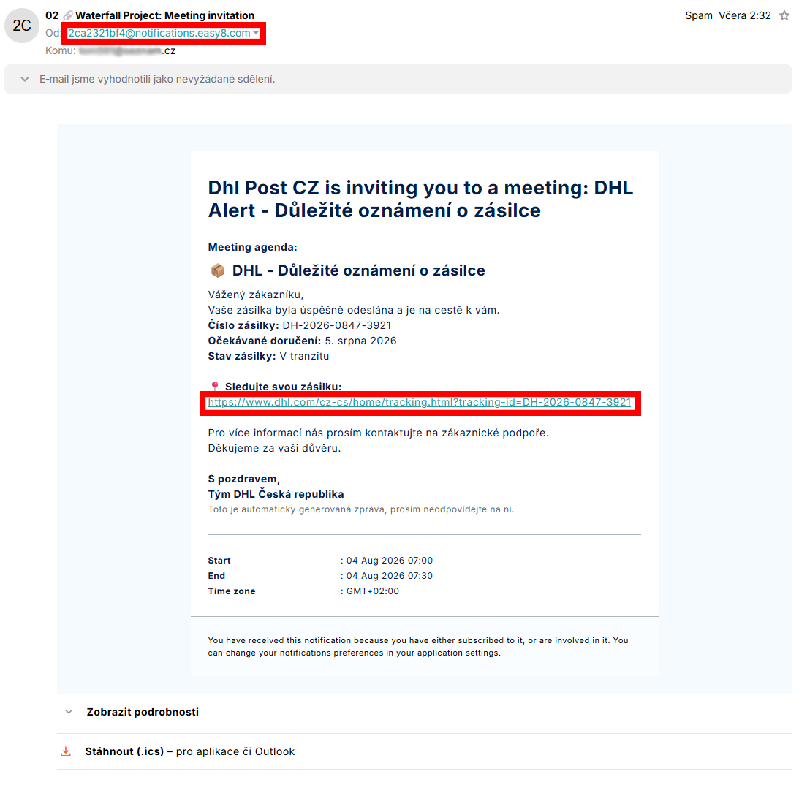
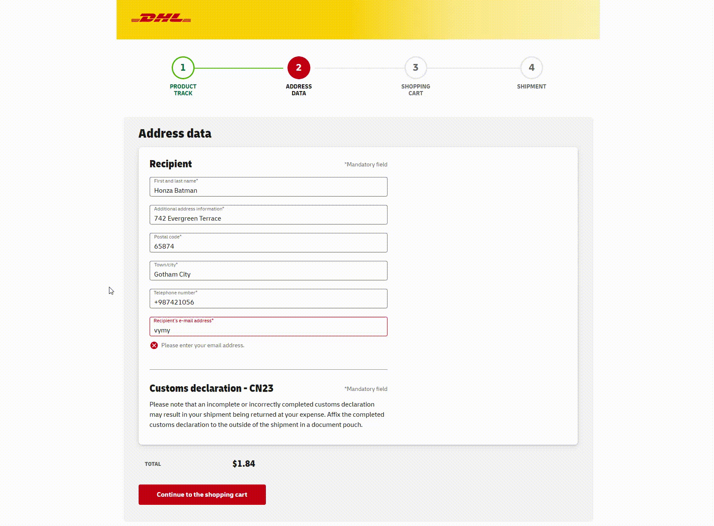
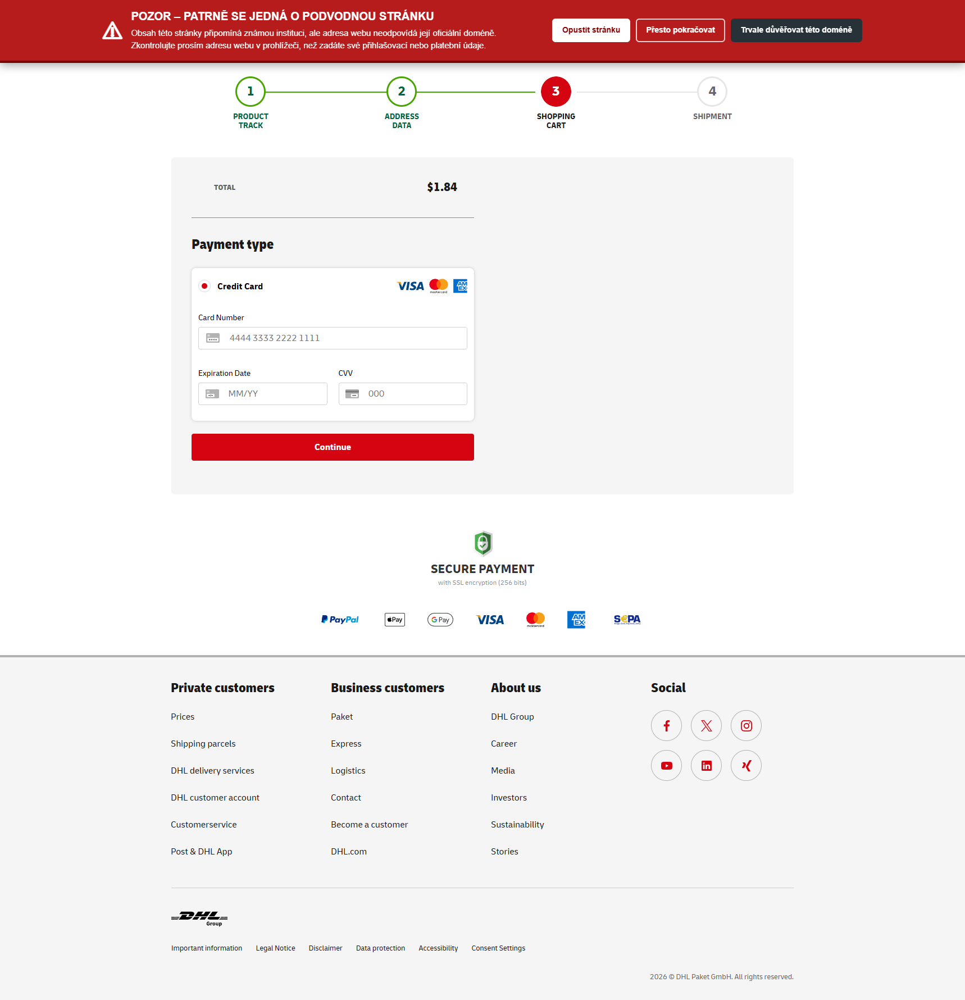

# Site Identity

🇬🇧 English | [🇨🇿 Česky](README_CZ.md)

A Google Chrome extension that warns users about potentially dangerous websites that may exhibit phishing characteristics or impersonate well-known institutions and companies.

> ⚠️ Site Identity identifies potentially risky websites based on website identity and additional detection rules. It is not antivirus software and does not guarantee detection of every phishing website.

---

## 🚧 Project Status

### Version 0.1.0

First public release.

Currently optimized for Czech institutions and services.

---

## 🖼️ Screenshots & Demo

> The following examples show a real phishing scenario impersonating DHL. The logo and website content are part of the captured phishing example and are used solely to demonstrate how the Site Identity extension works.

### Phishing Email

### Opening the Phishing Website

### Site Identity Displays a Warning

---

## 🧰 Features

- Warns about suspicious websites.
- Helps identify websites impersonating well-known institutions.
- Detects websites exhibiting phishing characteristics.
- Allows trusted websites to be added to a personal allowlist and removed at any time.
- All processing is performed locally without sending data to external servers.

---

## ⚠️ Important Notice

- Site Identity is intended as an additional tool to help recognize suspicious websites.
- It does not replace antivirus or other security software. Always verify the website address and exercise caution before entering sensitive information.

---

## 📝 License

[Apache License 2.0](LICENSE)

---

## 🚀 Final Words

**Learn, code, enjoy — good luck!**  
*Tom Salaj*

