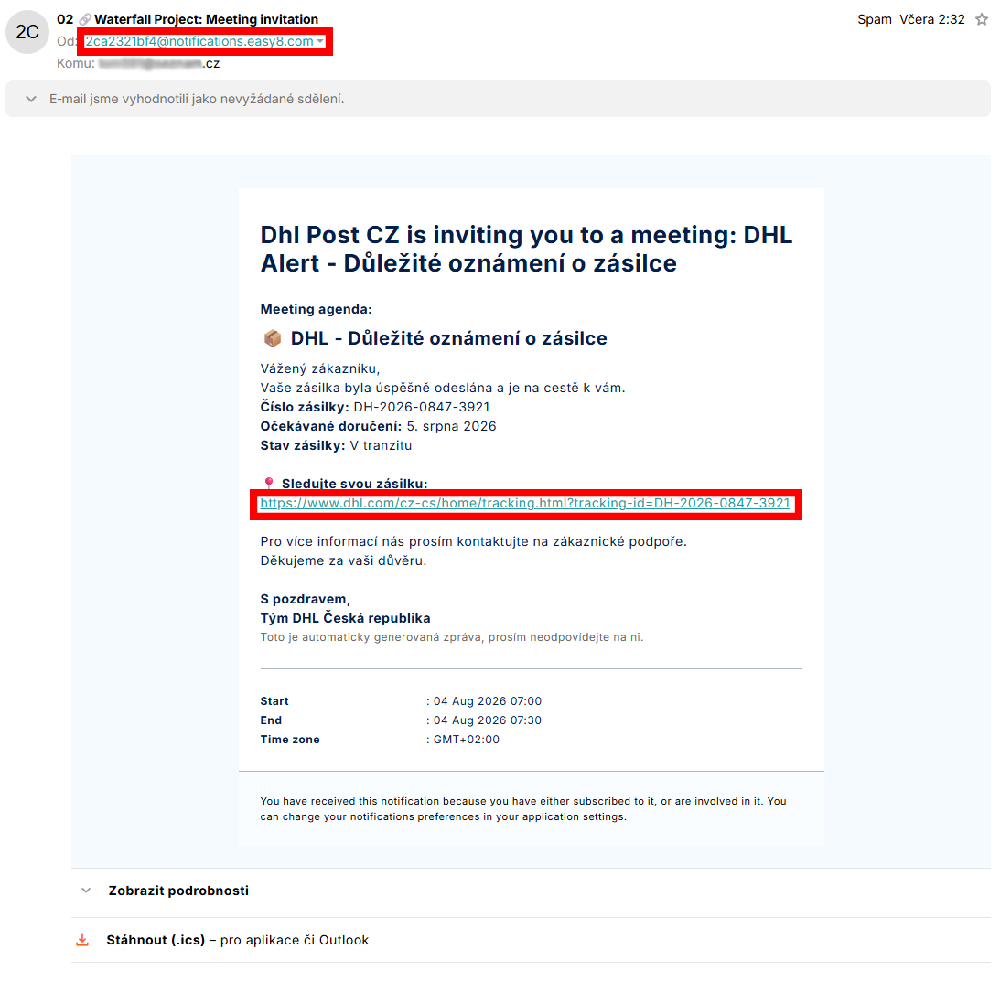
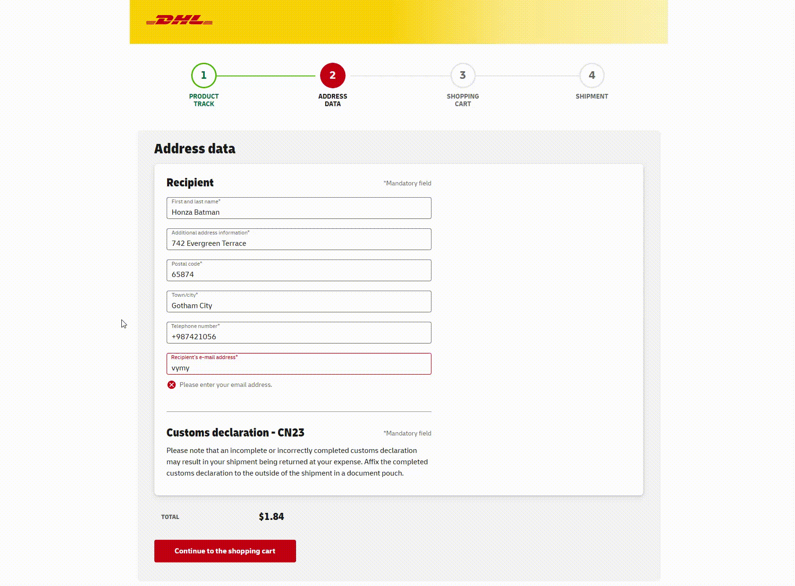
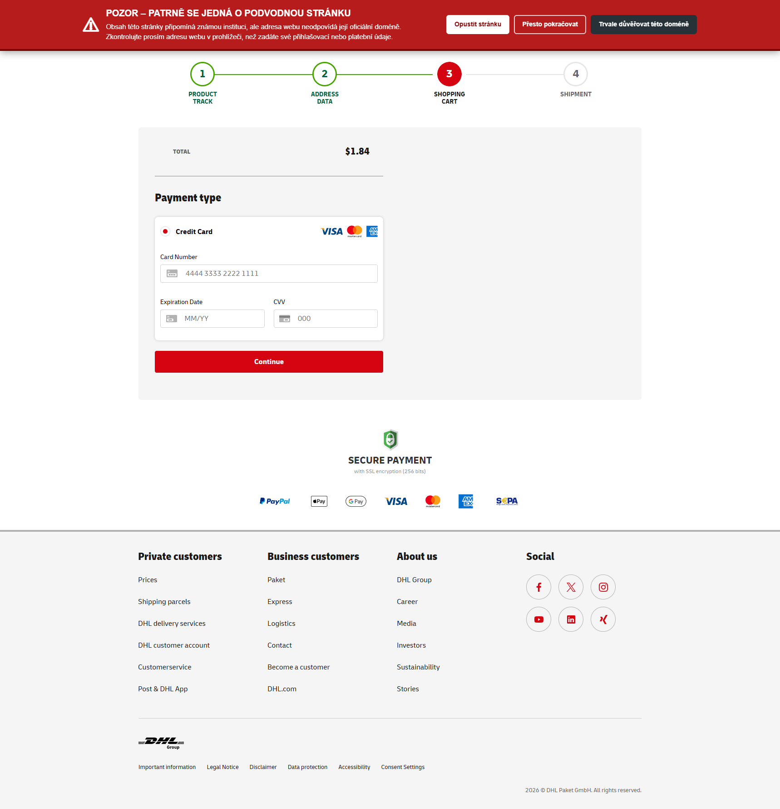

# Site Identity

[🇬🇧 English](README.md) | 🇨🇿 Česky

**[Nainstalovat z Chrome Web Store](https://chromewebstore.google.com/detail/jlnkgpeiammgcjblkjnkpnjlonjhfeog?utm_source=item-share-cb)**

Rozšíření pro Google Chrome, které upozorní na potenciálně nebezpečné stránky, jež mohou vykazovat znaky phishingu nebo se vydávat za známé instituce či společnosti.

> ⚠️ Site Identity upozorňuje na potenciálně rizikové stránky na základě identity webu a dalších detekčních pravidel. Nejedná se o antivirový software ani o záruku, že budou zachyceny všechny phishingové stránky.

---

## 🚧 Stav projektu

### Verze 0.1.1

Optimalizována detekční pravidla pro snížení výskytu falešně pozitivních upozornění.

### Verze 0.1.0

První veřejné vydání.

Aktuálně optimalizováno pro české instituce a služby.

---

## 🖼️ Screenshoty a demo

> Následující ukázky zachycují reálný phishingový scénář vydávající se za společnost DHL. Logo a obsah stránky jsou součástí zachyceného příkladu a slouží výhradně k demonstraci fungování rozšíření Site Identity.

### Phishingový e-mail

### Otevření phishingové stránky

### Site Identity zobrazí upozornění

---

## 🧰 Funkce

- Upozorňuje na podezřelé stránky.
- Pomáhá rozpoznat stránky vydávající se za známé instituce.
- Upozorňuje na stránky vykazující znaky phishingu.
- Umožňuje přidat důvěryhodné stránky do vlastního seznamu a kdykoliv je z něj odebrat.
- Lokální zpracování bez odesílání dat na externí servery.

---

## ⚠️ Důležité upozornění

- Rozšíření slouží jako doplňková pomůcka při rozpoznávání podezřelých webových stránek.
- Rozšíření nenahrazuje bezpečnostní software, vždy je doporučeno ověřit adresu webu a zachovat obezřetnost při zadávání citlivých údajů.

---

## 📝 Licence

[Apache License 2.0](LICENSE)

---

## 🚀 Final Words

**Learn, code, enjoy — good luck!**  
*Tom Salaj*

